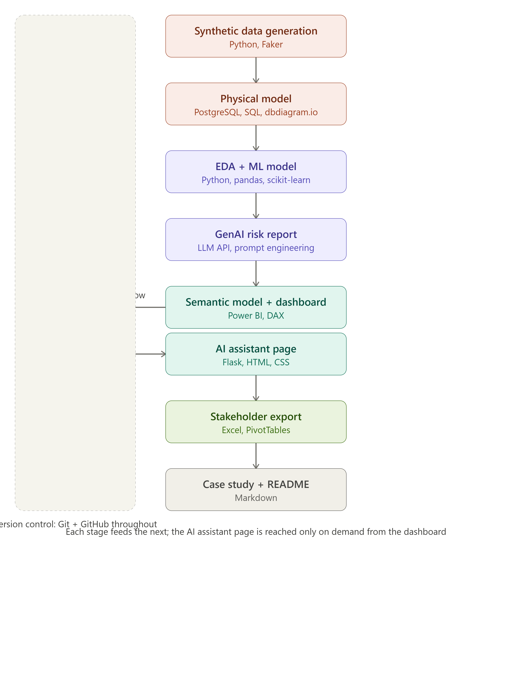
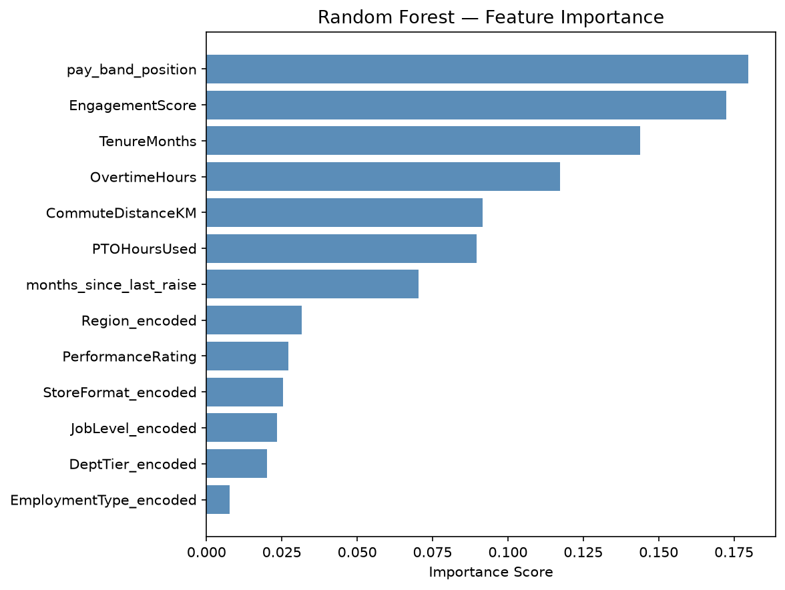

# HR Attrition Indicator | Status: in progress – currently building the model and testing features

A predictive and generative-AI decision-support prototype that flags employees at risk of leaving and separates **regretted attrition** (high performers leaving voluntarily) from healthy turnover, so HR and managers can act weeks before an exit instead of days after.

> **Data note:** All data in this repository is synthetic, generated with Python and Faker. No real employee, employer or customer data is used, and the retail setting is fictional.

---

## Business problem

Attrition is usually discovered at the point of resignation, when the replacement cost is already locked in. A single attrition rate also hides which exits matter: 15% turnover made up of top performers is a crisis, while 15% made up of low-performer churn is arguably healthy.

This project:

1. Scores each employee's attrition risk from known HR drivers.
2. Segments **regretted vs non-regretted** attrition so retention effort goes where it matters most.
3. Turns a risk score into a plain-English explanation and a concrete action plan a line manager can use.

The full case, including replacement-cost logic, is in [`docs/business_case.md`](docs/business_case.md).

## What is in this repo

| Component | Details |
|---|---|
| **Synthetic data generator** | `generate_data.py` builds a retail HR dataset in which attrition is driven by weighted HR factors (pay position in band, engagement, overtime, manager quality, tenure curve with spikes near month 12 and months 36 to 48). |
| **PostgreSQL star schema** | 9 tables: 8 dimensions (employee, department, store, date, compensation, promotion history, engagement survey, exit interview) and a monthly `Fact_Employment` snapshot table. |
| **Analytical SQL** | Queries in `sql/03_analytical_queries.sql` and six views in `sql/04_views.sql`: monthly attrition by department, regretted attrition, cost of attrition, tenure cohorts, manager clustering and high-risk employees. |
| **ML model** | Random Forest classifier in `notebooks/01_attrition_model.ipynb` with EDA, feature engineering, evaluation and risk tiers (Low / Medium / High). |
| **GenAI assistant** | Flask app (`web/app.py`) that calls an LLM through Groq (`llama-3.1-8b-instant`) using four focused prompts in `genai/prompts.py`: explain a prediction, generate a retention plan, summarise a risk profile, summarise exit-interview comments. |
| **Dashboard** | [Add a screenshot or link to the Power BI dashboard here, or delete this row if it is not published.] |

## Pipeline



## Data model


## Method

- **Features (13):** tenure, performance rating, engagement score, overtime hours, PTO used, pay-band position, commute distance, and encoded job level, employment type, department tier, region and store format.
- **Target:** `AttritionFlag`. A secondary `RegrettedAttritionFlag` marks high performers (rating of 4 or above) leaving voluntarily.
- **Model:** Random Forest with `class_weight='balanced'` to handle class imbalance, 80/20 stratified train/test split. Random Forest was chosen for non-linear effects (the tenure curve), robustness to outliers and built-in feature importance, which keeps the model auditable for HR.
- **Risk tiers:** predicted probability binned into Low (up to 0.3), Medium (0.3 to 0.6) and High (above 0.6).

## Results (on synthetic data)

- **Dataset:** 65,617 monthly employee records; monthly attrition rate of 3.0% (1,974 exits), of which 720 were regretted exits.
- **Top drivers by feature importance:** pay-band position (0.18), engagement score (0.17), tenure (0.14), overtime hours (0.12), commute distance (0.09). These match the relationships built into the generator, so they show the pipeline recovers known HR drivers. They are **not** findings about real employees.
- **Model performance:** ROC-AUC 0.60. On the exited class, precision is 0.06 and recall is 0.25.



## Limitations

- **Synthetic data only.** Results demonstrate the method, not real-world attrition behaviour.
- **Modest predictive power.** ROC-AUC of 0.60 is below the 0.70 level the notebook itself treats as acceptable. This is a prototype, not a production scoring tool.
- **Row-level train/test split.** The same employee can appear in both sets, which can make results look better than they would on unseen employees.
- **Uncalibrated risk tiers.** Tiers come from raw probabilities of a class-weighted model and should be read as a relative ranking, not a true likelihood.
- **Decision support, not decision making.** AI-generated explanations and plans should be reviewed by HR. A real deployment would also need privacy controls, bias and fairness testing, and legal review.

## Next steps

- Split train/test by employee to remove leakage and re-evaluate.
- Calibrate probabilities and test gradient boosting with SHAP-based explanations.
- Add engagement-trend features (the trend is a stronger signal than a single score).
- Publish the Power BI dashboard and stakeholder Excel export.
- Add `requirements.txt` and basic tests.

## Getting started

**Prerequisites:** Python 3.10+, PostgreSQL, a Groq API key.

```bash
pip install pandas numpy scikit-learn sqlalchemy psycopg2-binary faker flask groq joblib matplotlib seaborn
```

1. Create a PostgreSQL database named `hr_attrition`.
2. Set environment variables (never commit credentials):
   ```bash
   export DB_PASSWORD="your-postgres-password"
   export GROQ_API_KEY="your-groq-key"
   ```
3. Generate the data:
   ```bash
   python generate_data.py --employees 5000 --years 3 --outdir data
   ```
4. Build the database: run `sql/01_schema.sql` and `sql/02_indexes.sql`, then load the data:
   ```bash
   python load_data.py
   ```
5. Run `sql/03_analytical_queries.sql` and `sql/04_views.sql`.
6. Run `notebooks/01_attrition_model.ipynb` to train the model. It saves `data/model.pkl` and `data/model_features.pkl`.
7. Start the AI assistant:
   ```bash
   cd web && python app.py
   ```
   Open `http://localhost:5000/report?employee_id=1&action=explain`.
   Supported actions: `explain`, `retention`, `summary`, `exit`.

## Repository structure

```
HR-Attrition-Indicator/
├── generate_data.py        # synthetic data generator
├── load_data.py            # loads CSVs into PostgreSQL
├── sql/                    # schema, indexes, analytical queries, views
├── notebooks/              # EDA and attrition model
├── genai/prompts.py        # four domain-specific LLM prompts
├── web/                    # Flask AI assistant (app.py, templates/)
├── docs/                   # business case, ERD, flowchart, charts
└── LICENSE
```

## Tech stack

Python (pandas, scikit-learn, Flask, Faker), PostgreSQL and SQL, Groq LLM API, Power BI, Git and GitHub.

## License

MIT. See [`LICENSE`](LICENSE).

## Author

Panya Mota · [LinkedIn](https://www.linkedin.com/in/panya-mota/) · [GitHub](https://github.com/PanyaMota)
